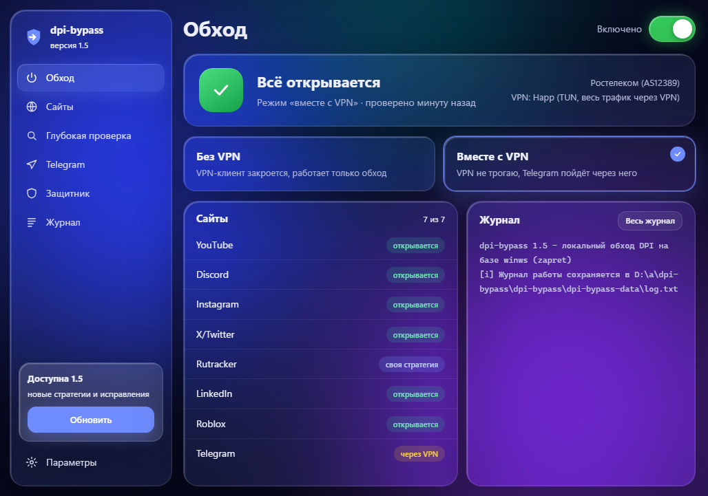
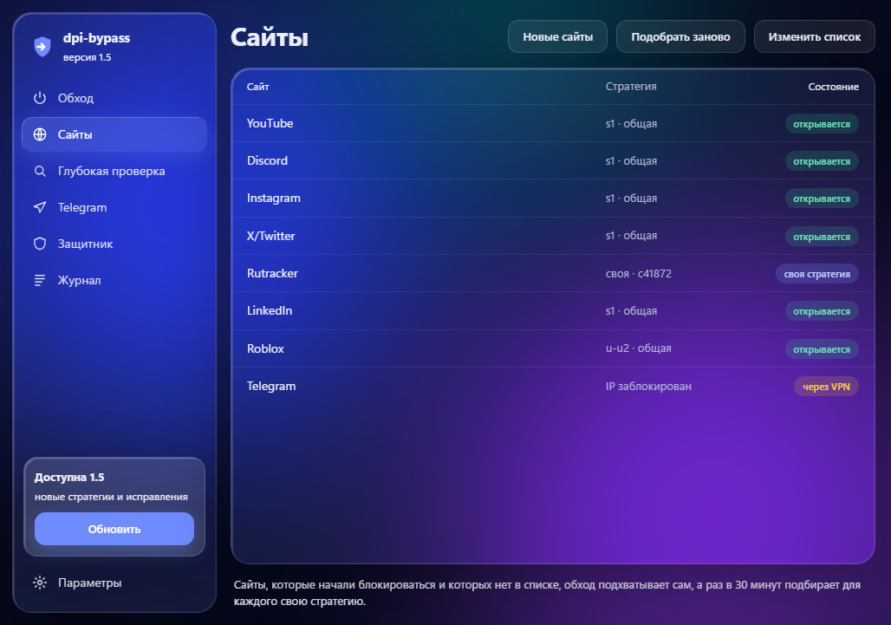
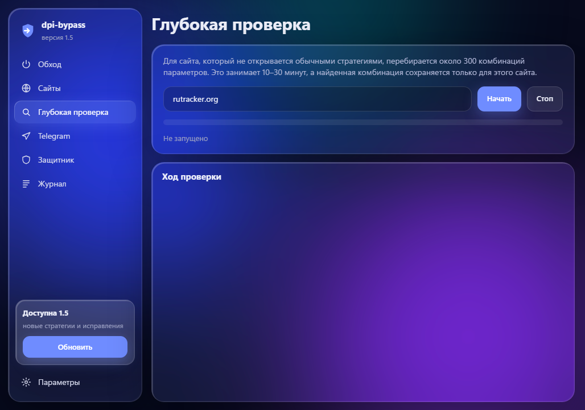
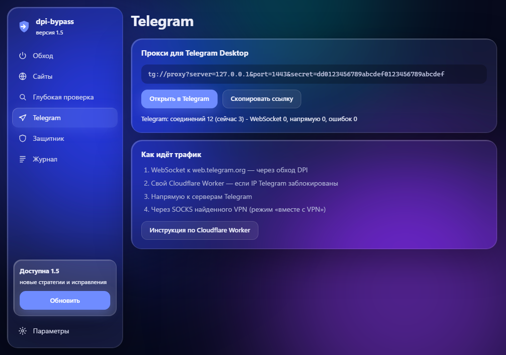
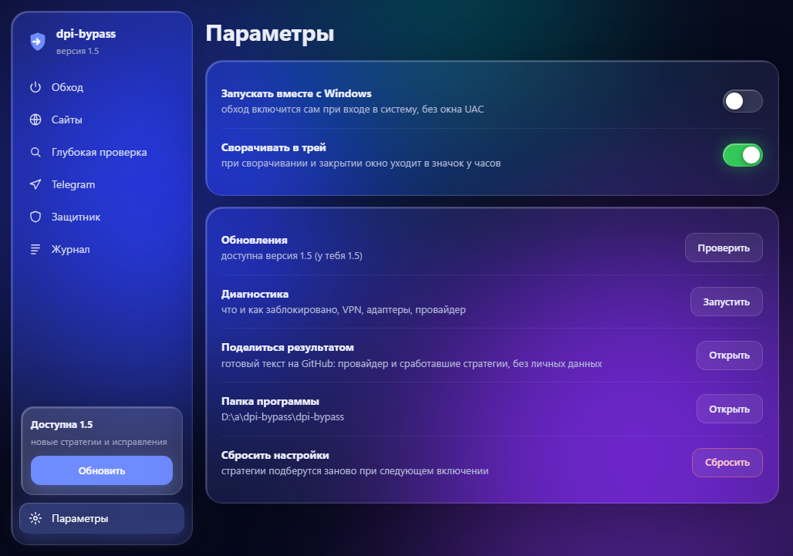
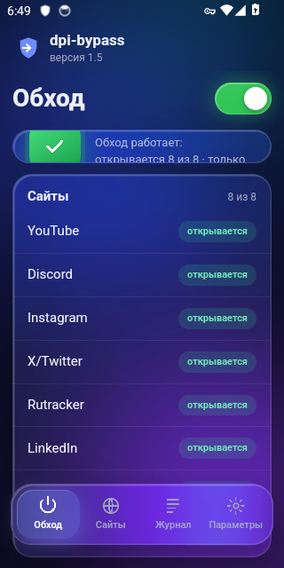
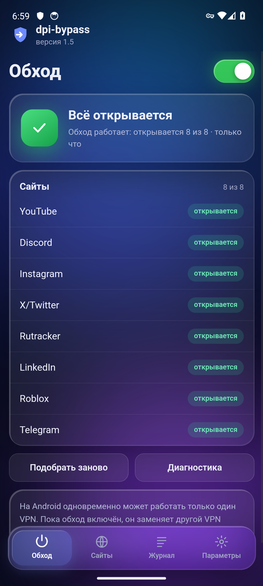
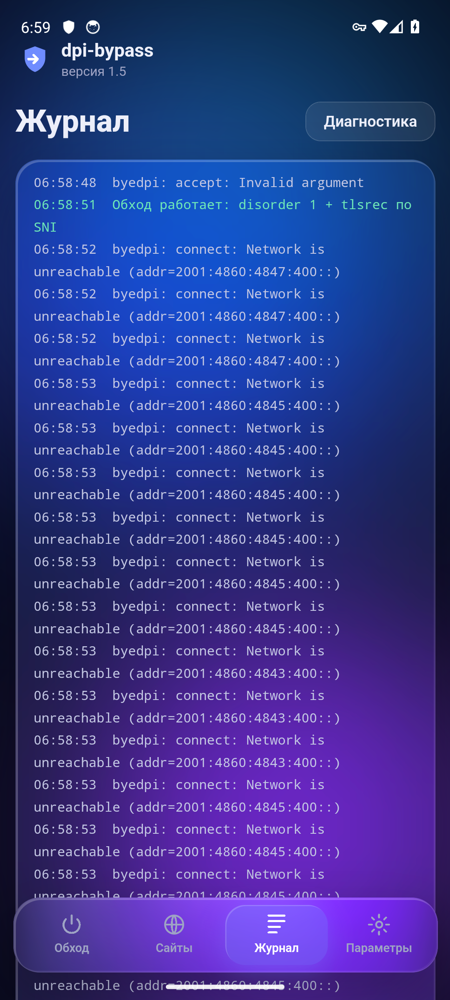

# dpi-bypass

<p align="center">
  <a href="https://github.com/LikFridman/dpi-bypass/raw/main/dpi-bypass.exe"></a>
  &nbsp;
  <a href="https://github.com/LikFridman/dpi-bypass/raw/main/dpi-bypass.apk"></a>
</p>

<p align="center">
  <b><a href="https://github.com/LikFridman/dpi-bypass/raw/main/dpi-bypass.exe">⬇ Windows 10/11 — dpi-bypass.exe</a></b>
  &nbsp;·&nbsp;
  <b><a href="https://github.com/LikFridman/dpi-bypass/raw/main/dpi-bypass.apk">⬇ Android 8+ — dpi-bypass.apk</a></b>
  <br><sub><a href="#windows">как установить на Windows</a> · <a href="#android">как установить на Android</a></sub>
</p>

Локальный обход DPI-блокировок для Windows и Android. Работает без VPN и своего сервера. Он сам подбирает рабочий способ обхода, умеет работать вместе с VPN-клиентами (Happ и другими) и пускает Telegram Desktop через WebSocket.

Движок для пакетов — [winws из проекта zapret](https://github.com/bol-van/zapret-win-bundle) (автор bol-van). dpi-bypass — обёртка над ним: она проводит диагностику, перебирает стратегии и следит, чтобы обход продолжал работать.



<details><summary>Ещё снимки: сайты, глубокая проверка, Telegram, параметры</summary>






</details>

Снимки делаются автоматически на GitHub Actions при каждой сборке: программа запускается на Windows, и её окно проверяется.

## Возможности

- **Диагностика.** По каждому сервису пишет в терминал, что именно не так: подменён DNS, заблокирован IP, сброс или зависание на TLS (DPI по SNI) или обрыв после ~16 КБ.
- **Перебор 12 стратегий.** fake, multisplit, multidisorder, fakedsplit, seqovl, syndata, hostfakesplit и другие. Если одна не помогла, пробуется следующая.
- **Свой обход для каждого сервиса.** Если одна стратегия не открывает всё, сервисы распределяются по нескольким стратегиям.
- **Автосписок.** Сайты не из списка, которые начали блокироваться, добавляются сами (`--hostlist-auto`).
- **QUIC / HTTP3, голос Discord, STUN.**
- **Сторож.** Раз в минуту проверяет сервисы. Если провайдер поменял блокировку, стратегия подбирается заново.
- **Работа вместе с VPN.** Распознаёт Happ, v2rayN, Hiddify, NekoRay, sing-box, Xray, Clash/Mihomo, AmneziaVPN/WG, WireGuard, OpenVPN, Outline, WARP и другие клиенты:
  - в режиме TUN обход привязывается к физическому адаптеру (Ethernet/Wi-Fi), и трафик внутри VPN не трогается;
  - соединения с сервером VPN исключаются из обработки;
  - проверки идут мимо VPN, поэтому видно реальное состояние блокировок;
  - если VPN включили, выключили или переподключили, обход перестраивается на лету;
  - программа сохраняет готовый список доменов для правил «Direct» в Happ (`dpi-bypass-data\vpn-direct-domains.txt`). С ним эти сайты идут напрямую через обход, а остальное — через VPN.
- **Telegram.** Встроенный локальный MTProto-прокси: Telegram Desktop подключается к `127.0.0.1`. Прокси пробует способы по очереди и запоминает, какие из них не работают:
  1. WebSocket к `kwsN.web.telegram.org`, как у web-версии Telegram. Этот трафик проходит через обход DPI.
  2. Свой Cloudflare Worker. Помогает, если IP-адреса Telegram заблокированы. Код: [`cloudflare-worker.js`](cloudflare-worker.js), разворачивается бесплатно за 2 минуты.
  3. Напрямую к дата-центру Telegram.
  4. Через локальный SOCKS5 найденного VPN-клиента (например, Happ). В этом случае через VPN идёт только Telegram, а остальное — через обход.

## Android

**[⬇ Скачать dpi-bypass.apk](https://github.com/LikFridman/dpi-bypass/raw/main/dpi-bypass.apk)** (Android 8 и новее)

1. Скачай APK на телефон и открой его. Если Android спросит, разреши браузеру «Установку неизвестных приложений».
2. Открой dpi-bypass и нажми переключатель. Android спросит разрешение на VPN, нажми «ОК».
3. Программа проверит сайты и сама подберёт стратегию. Готово: в строке состояния появится значок ключа.

На Android обход устроен иначе, чем на Windows. Приложение поднимает локальный VPN: трафик телефона идёт в туннель и через встроенный движок [byedpi](https://github.com/hufrea/byedpi) уходит в интернет напрямую. Сервер VPN не нужен, root тоже. Туннель в прокси переводит [hev-socks5-tunnel](https://github.com/heiher/hev-socks5-tunnel).

- Есть плитка «Обход DPI» в шторке: включать и выключать обход одним касанием.
- Обход может включаться сам после перезагрузки телефона, а в настройках Android его можно сделать «постоянным VPN».
- Свой фон, тот же стиль «Ночь», что и на Windows.
- На Android одновременно работает только один VPN: пока обход включён, он заменяет другой VPN (например, Happ). Сайты, заблокированные по IP, без настоящего VPN не откроются.

APK тоже собирается на GitHub Actions. Перед публикацией его проверяют в эмуляторе Android 14: запускаются все стратегии, сайт открывается через движок, поднимается VPN-туннель.

<p align="center">  </p>

## Windows

**[⬇ Скачать dpi-bypass.exe](https://github.com/LikFridman/dpi-bypass/raw/main/dpi-bypass.exe)** (Windows 10/11, x64)

Exe собирается на серверах GitHub из исходников этого репозитория ([Actions](../../actions)), посторонних файлов в нём нет. Контрольная сумма лежит в `dpi-bypass.exe.sha256`.

1. Положи `dpi-bypass.exe` в отдельную папку и запусти его двойным кликом. Windows спросит права администратора: они нужны драйверу WinDivert.
2. Откроется окно «Ночь»: тёмное жидкое стекло, боковая панель и плавные анимации. На Windows 11 под окном видно размытый рабочий стол (Acrylic). Если в системе нет WebView2 (компонент Edge), откроется простое окно с теми же кнопками.

| Кнопка | Что делает |
|---|---|
| **Включить обход (VPN выключится)** | чистый обход DPI; найденный VPN-клиент программа закроет (спросит) и выключит его системный прокси |
| **Включить обход вместе с VPN** | обход не трогает трафик VPN, а Telegram при необходимости идёт через VPN; если VPN включить или выключить позже, программа подстроится сама |
| **Выключить всё** | останавливает обход и выгружает драйвер WinDivert |
| **Диагностика** | показывает, что и как заблокировано, найденные VPN, адаптеры и провайдера |
| **Подобрать заново** | заново перебирает стратегии |
| **Новые сайты** | подбирает свою стратегию для каждого сайта, который winws сам добавил в автосписок (это делается и автоматически, раз в 30 минут) |
| **Глубокая проверка** | для указанного сайта перебирает ~300 комбинаций параметров (10–30 минут) и сохраняет найденную |
| **Стоп** | прерывает долгое действие |
| **Защитник** | помогает добавить исключение и вернуть файлы из карантина |
| **Telegram** | снова открывает ссылку локального прокси для Telegram |
| **Поделиться результатом** | открывает на GitHub готовый текст: провайдер и сработавшие стратегии (без личных данных) |
| **Запускать вместе с Windows** | при входе в систему обход включается сам, без окна UAC (через Планировщик заданий) |
| **Сворачивать в трей** | при сворачивании окно уходит в значок у часов; меню значка: включить, выключить, выход |
| **Обновления** | если на GitHub вышла новая версия, ставит её в один клик (с проверкой SHA-256) и перезапускается |

Журнал работы виден в окне и сохраняется в `dpi-bypass-data\log.txt`.

**Провайдер.** Программа определяет провайдера (Ростелеком, МТС, Билайн, Дом.ру и т.д.) и сначала пробует стратегии, которые у него уже срабатывали: свой опыт на этом компьютере и общие пресеты из `update/update.json`. Общие пресеты пополняются из результатов, которые присылают через «Поделиться результатом».

**Консоль.** Все действия доступны и командами: `dpi-bypass.exe console` (меню в консоли), `1`, `2`, `3`, `check`, `auto`, `tune`, `scan сайт`, `update`, `telegram`, `reset`.

Список сервисов лежит в `dpi-bypass-data\sites.txt`, его можно редактировать. После правки нажми «Подобрать заново».

## Защитник Windows

Защитник иногда помечает `winws.exe` и драйвер `WinDivert64.sys` как опасные. Причина в том, что они перехватывают сетевые пакеты, как это делают и вредоносные программы. Это ложное срабатывание, такое же бывает у zapret и GoodbyeDPI. Что сделано, чтобы срабатываний было меньше:

- exe собирается на GitHub Actions и содержит описание, версию, иконку и манифест, а права администратора запрашивает обычным окном UAC;
- права проверяются стандартным способом Windows, без обращения к диску напрямую;
- winws не встроен в exe, его скачивают с официального репозитория zapret (есть зеркало). Если Защитник что-то удалит, это будут только файлы winws, а не вся программа.

Если файлы всё же пропадают, выбери в меню **пункт 6**. Программа откроет нужную страницу Защитника и скопирует путь к папке, а исключение ты добавишь сам. Удалённое можно вернуть там же: «Журнал защиты» → «Восстановить». Ложное срабатывание можно отправить в Microsoft на [странице подачи файлов](https://www.microsoft.com/wdsi/filesubmission).

## Обновление стратегий

При запуске программа скачивает [`update/update.json`](update/update.json) из этого репозитория: новые стратегии и сервисы. Если провайдер поменял блокировки, достаточно добавить стратегию в этот файл, и у всех она появится без новой версии exe. Из файла принимаются только параметры `--dpi-desync*`, без путей к файлам. Корректность файла проверяют тесты в Actions.

## Лог

Всё, что выводится в окне, сохраняется в `dpi-bypass-data\log.txt` (предыдущий запуск — `log-old.txt`). Если что-то не работает, пришли этот файл.

## Ограничения

- **Блокировка по IP.** Локально её не обойти. Программа покажет такие сайты, для них нужен VPN.
- **Подмена DNS.** Исправляется в браузере: включи «Безопасный DNS» (DoH).
- **Звонки в Telegram.** Через прокси Telegram их не поддерживает.
- **Заблокированные IP Telegram.** Если провайдер блокирует их по IP (`check` покажет «нет TCP-соединения»), WebSocket к web.telegram.org тоже не пройдёт. Тогда нужен Cloudflare Worker или VPN.

### Cloudflare Worker для Telegram

1. Зайди на [dash.cloudflare.com](https://dash.cloudflare.com) → Workers & Pages → Create → Worker → Deploy.
2. Нажми «Edit code», вставь [`cloudflare-worker.js`](cloudflare-worker.js) и снова нажми Deploy.
3. Впиши адрес `имя.аккаунт.workers.dev` в `dpi-bypass-data\telegram-worker.txt` и перезапусти программу.
- **Антивирус.** Защитник Windows может ругаться на WinDivert и winws. Это ложное срабатывание из-за перехвата пакетов. Если файлы пропадают, добавь папку в исключения.
- **Конфликты.** Не запускай одновременно GoodbyeDPI, ByeDPI или другой zapret. Если их служба работает в фоне, программа найдёт её и предложит остановить.
- **Windows на ARM (Snapdragon).** Драйвер WinDivert для ARM64 официально не подписан, поэтому обход DPI там не запустится. Прокси для Telegram работать будет.

## Сборка

```
go build -ldflags "-s -w" -o dpi-bypass.exe .
```

Нужен Go 1.24 и выше. Внешних зависимостей нет. Собирается и на Linux: `GOOS=windows GOARCH=amd64`. Тесты прокси Telegram: `go test .`

## Благодарности

- [bol-van/zapret](https://github.com/bol-van/zapret) — winws и стратегии обхода.
- [hufrea/byedpi](https://github.com/hufrea/byedpi) — движок обхода DPI в Android-версии (MIT).
- [heiher/hev-socks5-tunnel](https://github.com/heiher/hev-socks5-tunnel) — туннель VPN → SOCKS в Android-версии (MIT).
- [Flowseal/tg-ws-proxy](https://github.com/Flowseal/tg-ws-proxy) — идея MTProto → WebSocket для Telegram (здесь своя реализация на Go).

Проект для личного использования. Ты сам отвечаешь за соблюдение законов своей страны.
